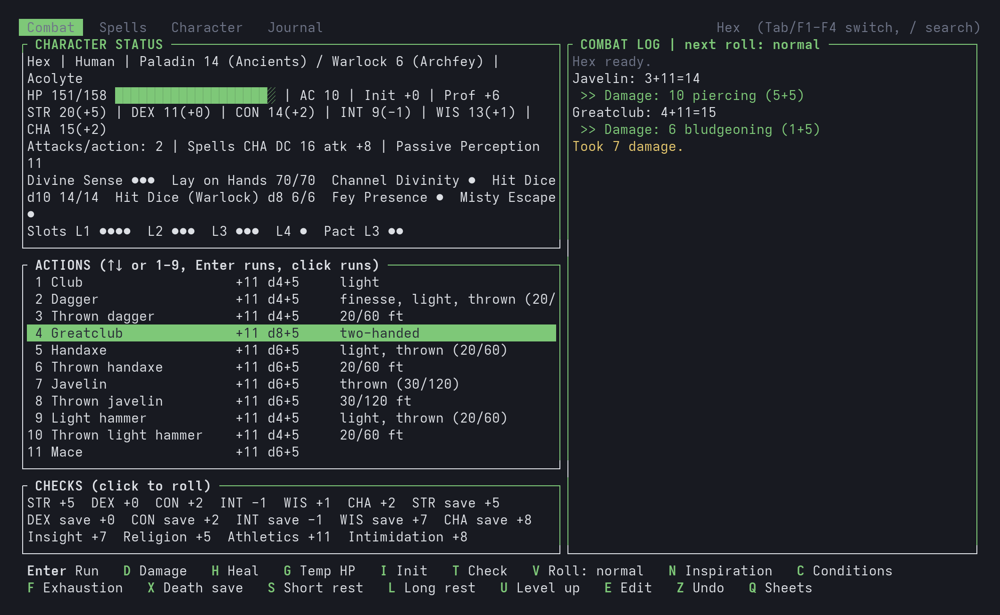
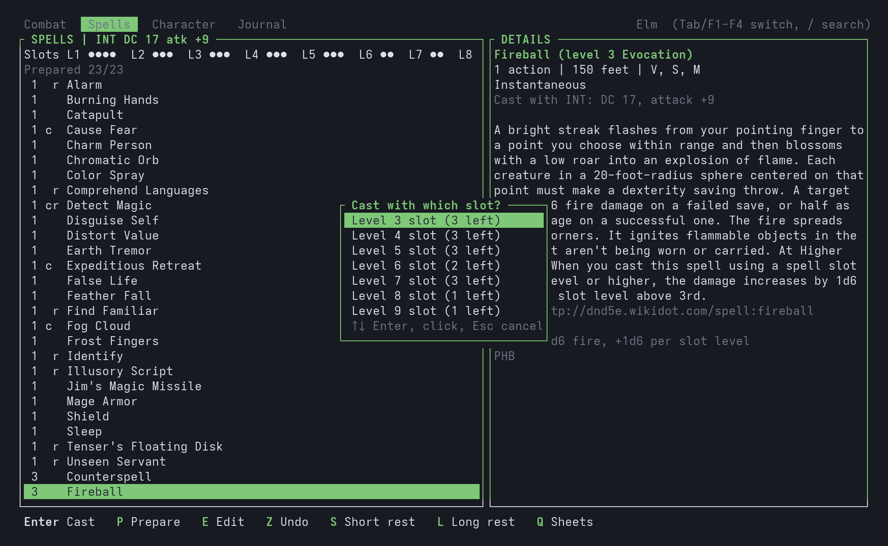
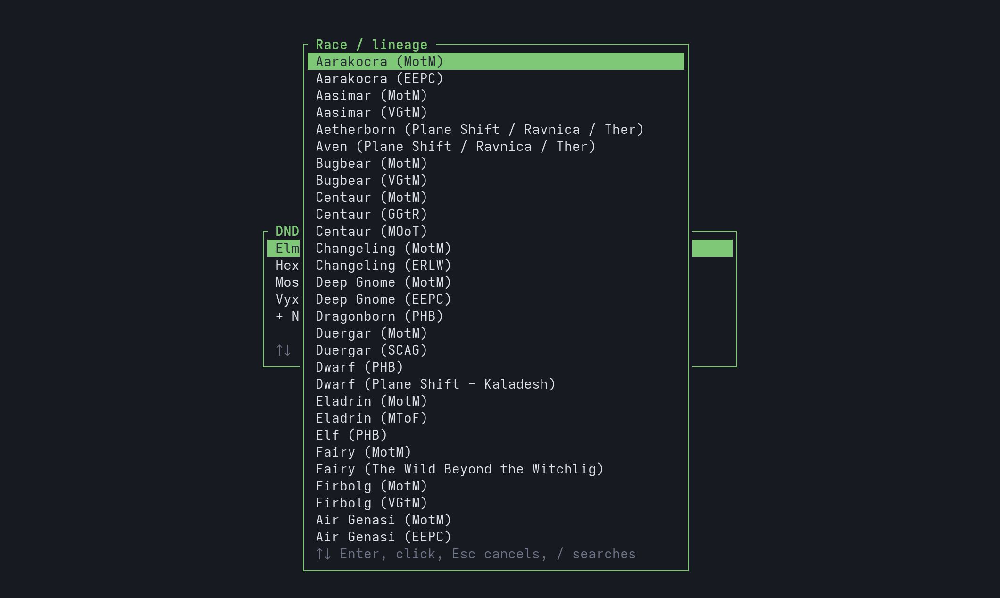

# dnd-TUI
Terminal character sheets for D&D 5e sessions, written in Rust ([ratatui](https://ratatui.rs)), inspired by [pythops](https://github.com/pythops/bluetui)' work.

Scope: **D&D 5e, 2014 rules, official content only** (Player's Handbook and the other Wizards of the Coast books; no Unearthed Arcana, no homebrew). The 2024 rules are not covered.



| Casting Fireball | Character creation |
|---|---|
|  |  |

## Install
```
cargo build --release
install -Dm755 target/release/dnd-tui ~/.local/bin/dnd-tui
dnd-tui
```
Needs a recent stable Rust toolchain. Pick a sheet at start, or press `N` to create a character.

## Data
Each character is one JSON file in `~/.local/share/dnd-tui/` (`$XDG_DATA_HOME/dnd-tui/`), sheet and live state together, saved after every action. The bundled sheets in `data/characters/` are copied there on first run (the `.seeded` file marks it): delete a sheet to remove it; to get a bundled sheet back, delete it and `.seeded` (the other sheets are kept); drop a `.json` there to add a character. If the program crashes it writes the error, a backtrace and the last 40 inputs to `crash.log` in the same folder: please attach it to the issue.

## Keys
Keys are shown in the footer, and every footer button, list row, check and tab is clickable. `Tab` or `F1`-`F4` switch tabs, `/` searches lists, `Z` undoes, `Q` goes back to the sheets.

| Where | Key | Does |
|---|---|---|
| Sheets | `N` / `D` | new character (wizard: race, class, background, scores, skills, spells, gear) / delete |
| Sheets, Character | `P` | export the sheet as a printable PDF (A4) in the folder you started the program from: to play on paper |
| Combat | `Enter`, `1`-`9` | run an action: attack and damage rolls, healing, resources spent |
| | `D` / `H` / `G` | damage / heal / temporary HP (the higher value stays; damage takes them first) |
| | `I` / `T` / `V` | initiative / ability check, skill or save / next roll with advantage or disadvantage |
| | `C` / `F` / `X` | conditions / exhaustion level / death saves |
| | `N` | Heroic Inspiration: grant it, press again to spend it for advantage |
| | `M` / `P` | Battle Master maneuvers / counted items (ammunition, potions) |
| | `S` / `L` | short rest (spend hit dice) / long rest |
| | `U` | level up, in any class whose multiclass requirements you meet |
| | `E` | sheet editor: identity, scores, gear, feats, resources, notes, spells, inventory and coins |
| | `O` | end concentration |
| Spells | `Enter`, `C` | cast: slot level, attack or save DC, damage; rituals without a slot |
| | `P` / `E` | prepare / add or remove spells |
| Journal | `A` / `Del` | add / delete a note |

## Rules covered
- All 12 classes from level 1 to 20 with multiclassing: features, resources, pooled spell slots and pact slots, hit dice per class.
- Every Player's Handbook subclass has its mechanics (Channel Divinity options, Arcane Ward, Portent, Wild Magic surges, the Beast Master's companion, Wild Shape with the SRD beasts...). **Subclasses from other books are text only**: their features are listed with a summary and a link, without automation.
- Spellcasting: known, prepared and spellbook casters, upcasting, cantrip scaling, concentration with automatic CON saves, ritual casting.
- Exhaustion, conditions, temporary HP, death saves, Heroic Inspiration.
- Inventory: items with count and weight, attunement up to three, coins that make change when spent.

## Contributing
`cargo test` and `cargo clippy --all-targets -- -D warnings` must pass. The lists in `data/lists/` are generated, do not edit them by hand: change the scripts in `tools/` and run them with `python3 -I`, in this order: `fetch_lists.py`, `fetch_classes.py`, `fetch_classes.py fighter-ek barbarian`, `fetch_spells.py`, `fetch_options.py` (`fetch_beasts.py` on its own). Pages are cached in `/tmp/dnd-wikidot-cache`. Entries without a summary go to `/tmp/dnd-summaries-todo.json`: write one in your own words in `data/lists/summaries.json`. Then run `tools/check_copy.py` (it must find 0 copied strings) and `tools/audit_spells.py` (it must find 0 new differences with Open5e).

## License

The code is licensed under the GNU General Public License v3.0 or later (see `LICENSE`).

The lists in `data/lists/` keep the licenses of their sources: the Creative Commons Attribution-ShareAlike 3.0 License for the data derived from dnd5e.wikidot.com and the Creative Commons Attribution 4.0 International License for the SRD 5.1 data (`beasts.json`), as detailed in Credits below.

This is an unofficial fan project, not affiliated with or endorsed by Wizards of the Coast. Dungeons & Dragons is a trademark of Wizards of the Coast LLC.

## Credits

Races, classes, subclasses, backgrounds, feats, weapons, armor, spells and class options (`data/lists/`, built by the scripts in `tools/`) are derived from the pages of the D&D 5th Edition wiki at https://dnd5e.wikidot.com, licensed under the Creative Commons Attribution-ShareAlike 3.0 License (https://creativecommons.org/licenses/by-sa/3.0/); these derived lists are shared under the same license. Each entry keeps the name of the official sourcebook it comes from. Descriptions are not copied from the books: spells in the SRD 5.1 carry their SRD text (from the Open5e API, marked `"srd": true`), every other entry carries a short mechanical summary written for this project (`data/lists/summaries.json`, merged in by the generators) and a link to its wiki page, shown as `More:` in the sheet. `tools/check_copy.py` checks that no description shares 8 or more consecutive words with the cached wiki pages.

Beast and elemental statistics (`data/lists/beasts.json`, built by `tools/fetch_beasts.py` from the Open5e API) come from the System Reference Document 5.1 by Wizards of the Coast LLC, available at https://dnd.wizards.com/resources/systems-reference-document and licensed under the Creative Commons Attribution 4.0 International License (https://creativecommons.org/licenses/by/4.0/legalcode).
